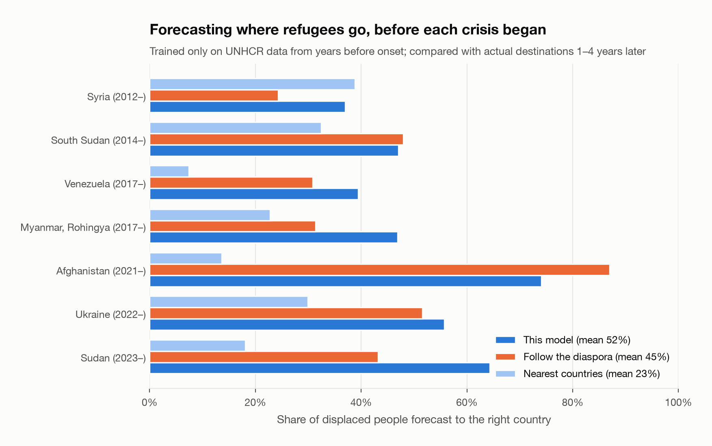
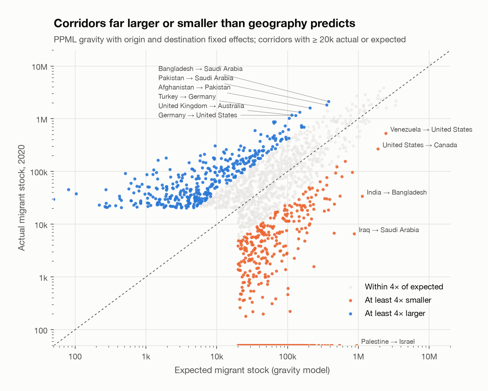
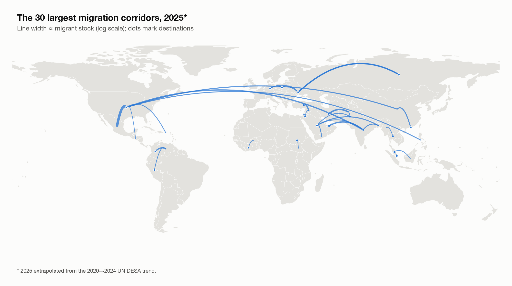
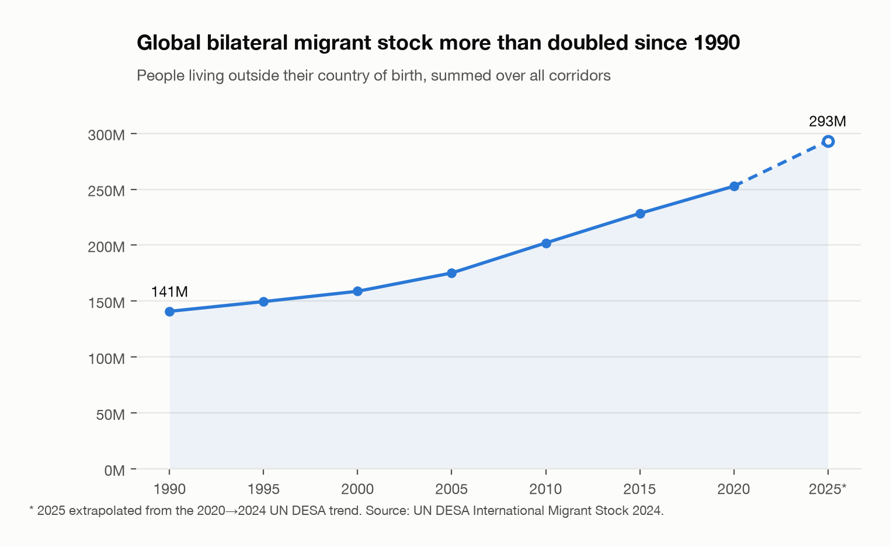
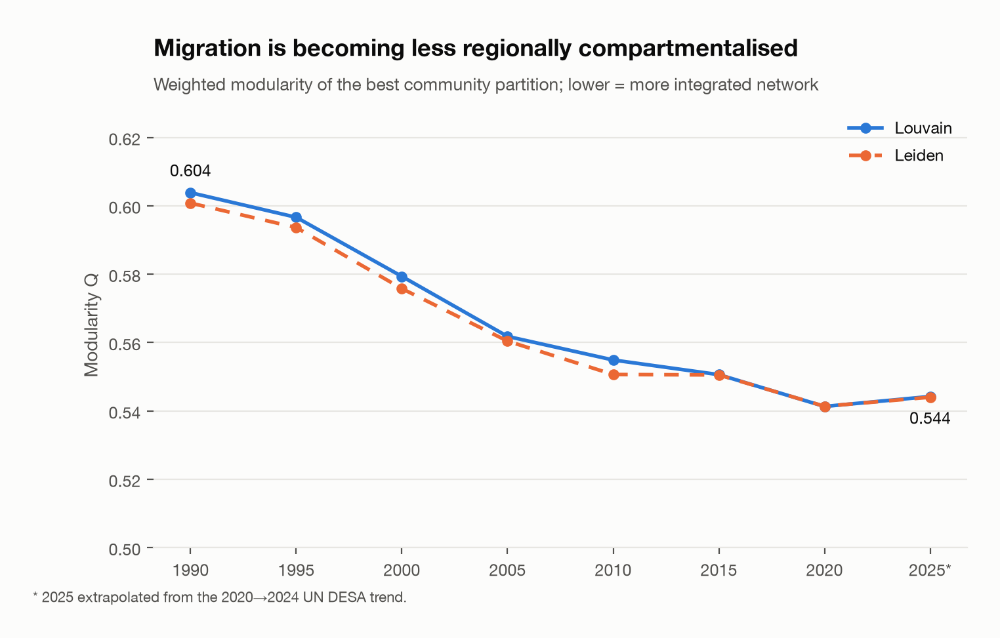
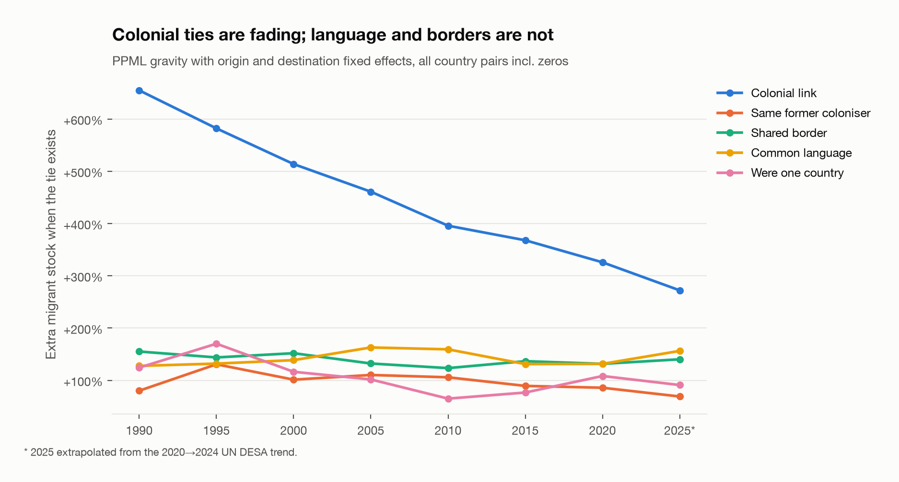
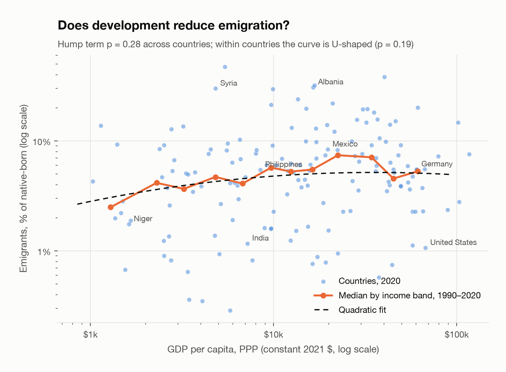
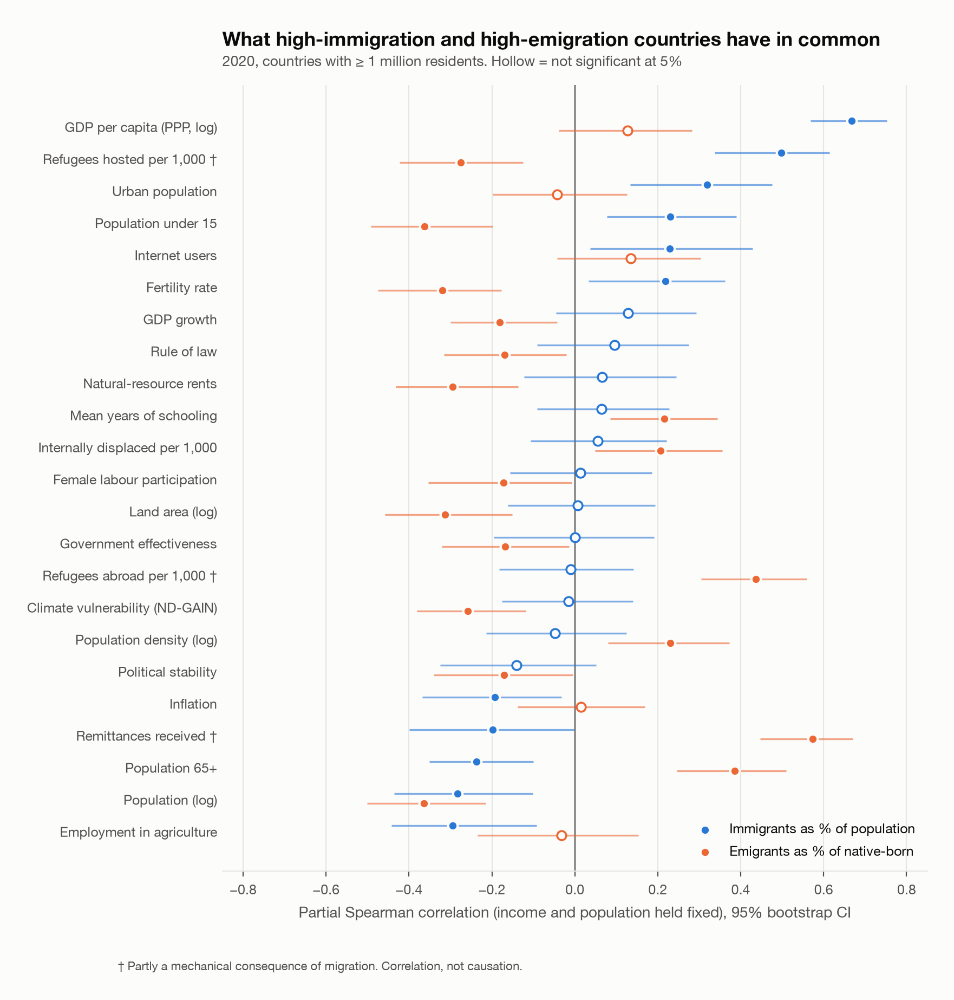

# Nodes & Nations

**Migration intelligence: forecast where people displaced by a crisis will go,
find the corridors that are larger or smaller than they should be, and explore
the global migration network, 1990–2025.**

[](https://github.com/Lazypilottt/Nodes_And_Nations/actions/workflows/ci.yml)
[](LICENSE)

## What it is for

| Who | Question | Where |
| --- | --- | --- |
| Humanitarian agencies, host governments, donors | A crisis has started. Where will displaced people go, and which countries will be under the most pressure? What changes if a neighbour closes its border? | **Displacement planner**: a forecast fitted on 25 years of UNHCR data and back-tested on seven real crises |
| Labour-mobility, diaspora and consular policy teams | Which corridors are far smaller than geography and ties predict (barriers worth negotiating away), and which are far larger (where services and integration support matter most)? | **Flows & gaps** |
| Analysts, journalists, students | What does migration look like for one country, how does it compare with its peers, and how exposed is it to displacement crises? | **Country brief**, with shareable links and CSV / PDF export |

<p align="center">
  
  
</p>

## How it works

Nodes & Nations treats the world's countries as nodes and bilateral migrant
stock as weighted, directed edges. Using 35 years of UN DESA data, it builds
eight network snapshots, measures which countries act as hubs and bridges,
detects regional migration blocs and how they shift over time, and asks what
high-immigration and high-emigration countries have in common across 34
measured factors. It estimates a structural gravity model (PPML) of what makes
a corridor large, flags corridors far from that model, trains a model that
predicts corridor size, and fits a destination-choice model on 25 years of
UNHCR data to forecast where people displaced by a crisis will go. An
interactive dashboard puts all of it on a map.

---

## Key findings

### Displacement forecasting

- **The forecast beats the obvious rules of thumb.** Trained only on years
  before each crisis began, the model assigns on average **52%** of displaced
  people to the right destination countries (3.7 of the actual top five),
  against 45% for "people follow the existing diaspora" and 23% for "people go
  to the nearest countries". It does best for Afghanistan (74%), Sudan (64%)
  and Ukraine (56%), and worst for Syria (37%): Turkey's open-door policy drew
  half of all Syrian refugees, but few Syrians lived there before 2012, so the
  forecast gave it 4%. Policy shifts like that are what the planner's
  closed/open border controls are for.
- **Borders and networks decide where refugees go; wealth barely does.** In
  the main model a shared border roughly triples a country's share, each
  doubling of the existing diaspora adds about 38%, and countries already
  hosting refugees attract more. A destination's income has no significant
  effect (p = 0.70); it matters only modestly once a crisis is under way and
  earlier destinations are known (p = 0.03).

### Corridor gaps

- The largest corridors **beyond** what geography predicts are labour-recruitment
  and guest-worker channels (Bangladesh and Pakistan → Saudi Arabia, Turkey →
  Germany), ethnic return (Kazakhstan → Germany), free movement (Poland → UK)
  and refugee flows (Afghanistan → Pakistan, Venezuela → Peru).
- The largest **shortfalls** sit behind closed or costly borders (Palestine →
  Israel, Iraq → Saudi Arabia, India → Bangladesh).

### The network

| | 1990 | 2025* |
| --- | --- | --- |
| Bilateral migrant stock | 140.8 M | 293.2 M |
| Active corridors | 8,006 | 9,042 |
| Louvain modularity *Q* | 0.604 | 0.544 |

<sub>*2025 is extrapolated from the 2020→2024 UN DESA trend.</sub>

- **The network is becoming more integrated.** Modularity declines steadily
  from 0.604 (1990) to 0.544 (2025): migration is less confined to regional
  blocs than it used to be. Louvain and Leiden agree closely in every year.
- **Most countries keep their bloc.** After tracking communities across years,
  only five countries (Aruba, Venezuela, Colombia, Eritrea, Marshall Islands)
  switch community in at least four of the seven transitions.
- **Size and income dominate.** In pooled OLS with country-clustered standard
  errors, log population and log GDP per capita are the strongest predictors of
  immigrant stock, and climate vulnerability has a significant negative effect.
  Population, GDP and conflict alone explain R² ≈ 0.69 of immigrant stock and
  0.77 of emigrant stock.
- **Modelled cultural indices add little.** Adding the integration-policy and
  cultural-openness indices does not significantly improve the inflow model
  (see the [data caveats](#data-sources--licensing)).
- **The largest corridor** in 2025 is Mexico → United States (≈11.3 M),
  followed by Afghanistan → Iran, Syria → Türkiye and Russia ↔ Ukraine.

### What drives migration

Results from [`notebooks/07_migration_drivers.py`](notebooks/07_migration_drivers.py).
Correlations are for 2020 across the roughly 150 countries with at least
1 million residents (fewer for sparse indicators), holding income (GDP per capita, PPP) and population
fixed. They describe what goes together, not what causes what.

- **Distance has not lost its grip.** In a PPML gravity model with origin and
  destination fixed effects, a 1% increase in distance lowers migrant stock by
  about 1.45% in 1990 and 1.50% in 2020. OLS on log stock, which drops the
  zero corridors, understates this at about 1.1–1.2.
- **Colonial ties are fading, language is not.** A former colonial link raised
  migrant stock by +655% in 1990 but only +326% in 2020. A shared language
  and a shared border (each ≈ +130% in 2020) held steady.
- **High-immigration countries** are rich and urban, with few jobs in
  agriculture. Beyond income, they also have younger populations and higher
  internet use.
- **High-emigration countries** are small, with older populations and lower
  fertility, partly because the departure of young adults itself ages a
  population. They have more schooling (+0.22), fewer natural-resource rents
  (−0.30) and slightly weaker governance (≈ −0.17).
- **Surprises.** Once income is held fixed, unemployment, inequality, homicide
  and armed-conflict intensity show no significant link to emigration rates.
  The most climate-vulnerable countries have *lower* emigration (−0.26), which
  is consistent with the "trapped populations" argument: those most exposed
  often lack the means to move.
- **No clear migration hump.** Emigration is lowest in the poorest countries
  and higher at middle incomes, but the inverted-U is not statistically
  significant (p = 0.28). Within countries over time the curve is, if anything,
  U-shaped. Both match the open debate between
  [Clemens (2020)](https://docs.iza.org/dp13614.pdf) and his critics.
- **Better data, better predictions.** Adding CEPII geography and the World
  Bank, governance and UNHCR indicators lifts the corridor model's held-out R²
  from 0.72 to 0.83, and it no longer uses any modelled index. Eight classic
  gravity variables alone (0.75) beat the original 31 features.

<p align="center">
  
</p>
<p align="center">
  
  
</p>
<p align="center">
  
  
</p>
<p align="center">
  
</p>

All figures live in [`Graphs/`](Graphs/) and are regenerated from the
pipeline outputs with `python scripts/make_figures.py`.

---

## Repository layout

```
api/            FastAPI service for the corridor-size model
dashboard/      Next.js dashboard (see dashboard/README.md)
data/
  raw/          Source datasets (UN DESA, CEPII GeoDist, ND-GAIN, Henley, UCDP, modelled indices)
    build_geography.py  Converts CEPII GeoDist to the UN DESA country codes
  processed/    Cleaned long-format migration table and country-year factors panel
  exports/      Analysis outputs consumed by the dashboard
  loader.py     Shared paths and loaders
  features.py   Dyad feature engineering shared by training and the API
  gravity.py    PPML and OLS gravity estimators with two-way fixed effects
models/         Trained edge-weight model
notebooks/      Pipeline steps 01–09 (plain Python scripts)
scripts/
  build_pipeline.py   Runs every pipeline step in order
  make_figures.py     Regenerates the figures in Graphs/
Graphs/         Static figures (PNG) generated from the exports
docs/           Project report
tests/          Unit tests (python -m pytest)
```

## Quick start

Requirements: Python 3.9+ (3.11 recommended) and Node.js 18.17+.

```bash
git clone https://github.com/Lazypilottt/Nodes_And_Nations.git
cd Nodes_And_Nations

python -m venv venv
source venv/bin/activate              # Windows: venv\Scripts\activate
pip install -r requirements.txt

# Optional: the exports are committed, so this is only needed after changes
python scripts/build_pipeline.py
python scripts/make_figures.py

cd dashboard
npm install
npm run dev                           # http://localhost:3000
```

## The pipeline

Each step is a standalone script in `notebooks/` and can be run on its own.
`scripts/build_pipeline.py` runs them in order (`--skip-graph` skips 02,
`--skip-train` skips 06).

| Step | Script | What it does |
| --- | --- | --- |
| 01 | `01_data_collection_cleaning.py` | Parses the UN DESA origin–destination matrix (both sexes), extrapolates 2025, and builds a country-year panel of covariates: 26 World Bank indicators (economy, demography, connectivity, safety, and the Worldwide Governance Indicators), UNHCR refugee and IDP stocks, UNDP education, UCDP conflict, Henley visa openness, ND-GAIN climate vulnerability, CEPII landlocked status and area, and the modelled religion and integration indices. Each snapshot takes that year's value, or the mean of values within ±2 years. API responses are cached in `data/raw/cache/`. |
| 02 | `02_network_construction_centrality.py` | Builds one weighted directed graph per snapshot year and computes degree, strength, betweenness and weighted PageRank, plus network-level summaries. |
| 03 | `03_community_detection.py` | Runs Louvain, Leiden and Girvan–Newman, compares them (NMI/ARI), aligns communities across years with Hungarian matching, and measures temporal drift (Jaccard) and boundary nodes. |
| 04 | `04_regression_analysis.py` | Fits baseline, full, cultural-gravity and development OLS models for log immigrant and emigrant stock (pooled with country-clustered SEs, and year by year), with VIF diagnostics. |
| 05 | `05_export_finalization.py` | Writes `nodes_master.csv` (country-year) and `migration_full_flat.csv` (corridor-level), plus metadata, community labels and summary statistics. |
| 06 | `06_edge_weight_predictor.py` | Trains a gradient-boosting model of log corridor stock on all corridors, with a train/test split grouped by corridor, an ablation over feature groups and a 1990–2015 → 2020 forecast check. |
| 07 | `07_migration_drivers.py` | Correlates 34 factors with immigration and emigration rates (raw and holding income and size fixed, with bootstrap CIs), profiles the top and bottom fifth of countries, tests the migration hump, and estimates PPML gravity for every snapshot. |
| 08 | `08_displacement_forecast.py` | Downloads UNHCR origin × host displacement data (2000–2024), fits two PPML destination-choice models with origin × year fixed effects (geography, diaspora and host attributes; plus last year's destinations) and averages them, back-tests on seven crises against two baselines, and writes forecast shares for every origin. |
| 09 | `09_corridor_potential.py` | Fits PPML gravity with origin and destination fixed effects to all country pairs in 2020 and flags corridors at least 4× larger or smaller than expected. |

### Main outputs (`data/exports/`)

| File | Grain | Contents |
| --- | --- | --- |
| `nodes_master.csv` | country × year | Centrality, community, boundary score, socio-economic and cultural covariates |
| `migration_full_flat.csv` | corridor × year (top 500/year) | Corridor weight with origin and destination attributes and dyadic indicators |
| `network_edges.csv` | corridor × year (top 500/year) | Origin, destination, weight |
| `modularity_scores.csv` | year × algorithm | Modularity, community count, NMI/ARI agreement |
| `boundary_nodes.csv` | country | Community switches across the seven transitions |
| `regression_*.csv`, `vif_analysis.csv` | model × predictor | Coefficients, standard errors, fit statistics |
| `edge_model_metrics.json` | — | Held-out performance of the corridor model |
| `edge_model_ablation.csv` | feature set | Held-out R² as each data source is added |
| `drivers_correlations.csv`, `drivers_profile.csv` | outcome × factor | Correlates of immigration and emigration rates; top/bottom-fifth medians |
| `country_migration_profile.csv` | country × year | Immigrant share, emigrant rate, GDP per capita (PPP) |
| `migration_hump.csv`, `migration_hump_curve.csv` | specification | Emigration–income regressions and plotting curve |
| `gravity_ppml.csv`, `gravity_fit.csv` | estimator × year × term | PPML and OLS gravity coefficients and fit |
| `displacement_shares.csv` | origin × destination | Forecast share of a crisis's displaced population going to each of the top 60 destinations |
| `displacement_backtest.csv`, `displacement_backtest_shares.csv` | crisis × method | Back-test accuracy (model vs diaspora-only vs nearest-country) and predicted vs actual shares |
| `displacement_model.csv`, `displacement_meta.json` | model × term | Destination-choice coefficients and run metadata |
| `corridor_potential.csv` | corridor | Actual vs expected 2020 stock, ratio and gap |

The complete corridor table (all ~9,000 corridors per year) is
`data/processed/migration_long.csv`.

## Corridor-size prediction API

```bash
python -m uvicorn api.predict:app --reload --port 8001
```

```bash
curl -X POST localhost:8001/predict \
  -H 'Content-Type: application/json' \
  -d '{"origin_iso3": "IND", "dest_iso3": "USA", "year": 2020}'
```

Returns the predicted `log1p` stock, the predicted stock, and any input
features that were missing for that pair. You can also pass a precomputed
`features` object. `GET /health` reports whether the model is loaded. Interactive
docs are at `http://localhost:8001/docs`.

The model is a histogram gradient-boosting regressor over 83 origin,
destination and dyadic features: size and income, CEPII distance and ties,
development, governance and displacement indicators, and each endpoint's
diaspora in the previous snapshot. On corridors it never saw during training it
reaches **R² ≈ 0.83** on log stock, up from 0.72 for the first version; trained
on 1990–2015 it predicts 2020 with R² ≈ 0.86 (see
`data/exports/edge_model_metrics.json` and `edge_model_ablation.csv`). Because
the split is grouped by corridor, this measures generalisation to new country
pairs rather than interpolation between years of known ones. The served model
uses measured data only.

## Dashboard

See [dashboard/README.md](dashboard/README.md). Eight views: an animated
corridor map; the **displacement planner** (forecast, closed borders, pressure
on each host, back-test evidence); **country briefs**; **flows & gaps** (a
chord diagram of migration between regions, regional trends and the corridor
gap explorer); migration drivers; network structure; distributions; and a
two-country comparator. Light and dark themes follow the system setting, the
URL records the view, year and country so any screen can be shared, and motion
is reduced when the operating system asks for it.

## Data sources & licensing

| Data | Source | Notes |
| --- | --- | --- |
| Bilateral migrant stock | [UN DESA, International Migrant Stock 2024](https://www.un.org/development/desa/pd/content/international-migrant-stock) | Both sexes, mid-year, 1990–2024. 2025 extrapolated. |
| GDP, population, labour, demography, connectivity, homicide (23 indicators) | [World Bank WDI](https://data.worldbank.org/) (API) | CC BY 4.0. Codes listed in `WB_INDICATORS` in step 01. |
| Political stability, government effectiveness, voice & accountability, rule of law | [Worldwide Governance Indicators](https://www.worldbank.org/en/publication/worldwide-governance-indicators) (World Bank API) | 1996 onward; back-filled to 1990 and 1995. |
| Refugees, asylum seekers, internally displaced | [UNHCR Refugee Data Finder](https://www.unhcr.org/refugee-statistics/) (API) | By country of origin and of asylum, and origin × host pairs for 2000–2024 (refugees + asylum seekers + others in need of international protection). |
| Distance, contiguity, common language, colonial ties, landlocked, area | [CEPII GeoDist](https://www.cepii.fr/CEPII/en/bdd_modele/bdd_modele_item.asp?id=6) (Mayer & Zignago, 2011) | 2004 vintage, mapped to current codes by `data/raw/build_geography.py`. |
| Education index | UNDP Human Development Reports | |
| Conflict intensity | UCDP/PRIO Armed Conflict Dataset | |
| Visa openness | Henley Passport Index | |
| Climate vulnerability | ND-GAIN Country Index | |
| Religion profile | **Modelled** — `data/raw/generate_cultural_datasets.py` | Regional baselines with exact figures for about 30 countries, informed by Pew Research. |
| Integration & cultural-openness indices | **Modelled** — `data/raw/generate_cultural_datasets.py` | MIPEX-*style* scores from regional archetypes plus a linear time trend. Not official MIPEX data. |

> **Caveat.** The religion and integration indices are synthetic approximations
> built for this project, not measured data. Treat any result that depends on
> them (cultural-gravity regressions, the religion/integration breakdowns, the
> kinship and integration options in the planner's what-if engine) as illustrative.
> Replacing them with sourced data is the most valuable contribution you could
> make; see [CONTRIBUTING.md](CONTRIBUTING.md).

The source code is released under the [MIT License](LICENSE). Third-party
datasets in `data/raw/` remain subject to their providers' terms; cite the
original sources when reusing them.

## Limitations

- Migrant **stock** is not **flow**: a corridor's value counts people living
  abroad at a point in time, not movements in a period.
- 2025 values are a one-year geometric extrapolation from 2024 and are marked
  `is_extrapolated` in `migration_long.csv`.
- Girvan–Newman runs on a reduced subgraph (edges covering 80% of total
  weight) for tractability, so its modularity is not comparable to
  Louvain/Leiden.
- The displacement forecast learns from where refugees and asylum seekers are
  *recorded*, so destinations with weak registration (and people who move
  without claiming protection) are under-represented. It cannot anticipate a
  border closure or a destination that is itself the threat: the planner's
  "closed borders" control exists for that (for example, closing China in a
  Taiwan scenario).
- The "what-if scenario" engine in the planner is hand-tuned and not
  validated; its borders, languages and colonial ties are measured (CEPII) and
  weighted by the PPML estimates, but the scenario weights are not.
- Corridor gaps compare 2020 stock with a gravity model that knows geography
  and history but not policy, so a "gap" is a prompt for investigation, not
  proof of a barrier or of untapped demand.
- The driver analysis is cross-sectional and correlational. Some factors
  (remittances, refugee counts, an older population) are partly consequences
  of migration; they are flagged in the outputs.
- CEPII GeoDist dates from 2004. Successor states inherit their predecessor's
  ties, and nine small territories it omits were added by hand.

## Related work

This project sits next to a substantial literature and a few public tools:

- **Migration as a network.** [Fagiolo & Mastrorillo (2012)](https://www.lem.sssup.it/WPLem/2012-23.html)
  describe the International Migration Network's small-world, modular
  structure and show a gravity model reproduces most of it.
  [*Structure and Dynamic of Global Population Migration Network*](https://arxiv.org/abs/2006.02208)
  follows communities and core–periphery structure from 1960 to 2015. Most of this work uses the World
  Bank 1960–2000 matrices; this project uses UN DESA 1990–2024.
- **Flows rather than stocks.** [Abel & Cohen](https://figshare.com/articles/dataset/7731233)
  estimate bilateral *flows* from successive stock tables (updated in 2025 for
  the 2024 UN DESA release). They would be the natural next input for
  modelling movement rather than accumulated stock.
- **Gravity models of migration.** PPML with origin and destination fixed
  effects is the standard estimator
  ([Beine, Bertoli & Fernández-Huertas Moraga, 2016](https://e-archivo.uc3m.es/entities/publication/c38a573d-2fb4-42f4-8cfe-c91119769c76));
  `data/gravity.py` implements it without dummy matrices and is tested
  against statsmodels.
- **Dashboards.** The IOM [Migration Data Portal](https://www.migrationdataportal.org/)
  and UN DESA publish country-level views. What this project adds is the
  network layer (centrality, communities and their drift), the driver
  analysis, and a corridor-level predictive model in one open pipeline.

## Contributing

Contributions are welcome. Please read [CONTRIBUTING.md](CONTRIBUTING.md) and
the [Code of Conduct](CODE_OF_CONDUCT.md). Report security issues privately as
described in [SECURITY.md](SECURITY.md).

## Citation

If you use this project, please cite it using [CITATION.cff](CITATION.cff)
(GitHub shows a "Cite this repository" button) and cite UN DESA for the
underlying migration data.

## License

[MIT](LICENSE) © Lazypilottt
